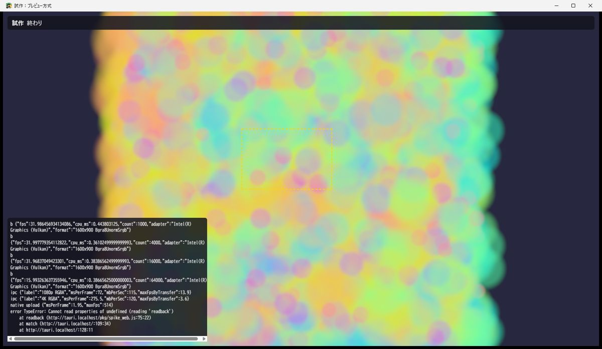

# 試作の結果：プレビューの方式（2026-11-26・MV-0002 の材料）

> γ0.1 の段階②。2つの方式を同じ描画のコードで作り、同じパソコンで測った。
> 試作のコード＝`apps/stario-mv/spikes/preview/`（測り直し方は同じフォルダの README）。生の数字＝同じフォルダの `results.json`。

## 比べた2つの方式

| | (a) WebAssembly＋WebGPU | (b) ネイティブの窓＋画面を重ねる |
|---|---|---|
| 描き方 | Rust の描画を WebAssembly にして、画面（WebView2）の中の WebGPU で描く | Rust の描画を窓に直接描き（wgpu→Vulkan/DX12）、透明にした画面（WebView2）を上に重ねる |
| 書き出し | 書き出しは別にネイティブで描く（同じ Rust のコード） | 同じ（プレビューも書き出しもネイティブ） |

## 測った環境（⚠️ 本番の上位 PC ではない）

- Intel 内蔵 GPU（Intel(R) Graphics）・リモートデスクトップ経由（画面の更新が約 32 回／秒に抑えられる）。
- 場面＝重なり合う半透明の丸を N 個、時刻で動かす（発光系の重なりに近い、塗りの重い絵）。
- ⚠️ 絶対値は上位 PC で大きく変わる。**2つの方式の比**と、**方式の構造から来る限界**を見る。

## 結果

### 1. GPU の速さ（画面なし・vsync なし・1920×1080・60コマの平均）

| 丸の数 | (a) WebGPU | (b) ネイティブ（Vulkan） |
|---|---|---|
| 16,000 | 24.2 ms／コマ | 19.3 ms／コマ |
| 64,000 | 93.1 ms／コマ | 76.3 ms／コマ |
| 256,000 | 380.1 ms／コマ | 306.4 ms／コマ |

→ **ネイティブが約 2 割速い**（どの重さでも同じ比）。

⚠️ 画面に出す速さ（requestAnimationFrame で数えた回数）では (a) は 64,000 でも「32 回／秒」と出たが、GPU は 1コマに 93 ms かかっている＝**(a) は描けていないコマを数えてしまう**（ブラウザが間引く）。(b) は 64,000 で 15.7 回／秒と正直に落ちた。

### 2. 大きなコマを Rust から画面へ送る速さ（映像の素材のコマを想定）

| 大きさ | (a) Rust → 画面（IPC） | (b) Rust → GPU（直接） |
|---|---|---|
| 1920×1080 RGBA（8.3 MB） | **約 75 ms**（約 13 コマ／秒・約 105 MB/秒） | **約 1.6 ms**（約 600 コマ／秒） |
| 3840×2160 RGBA（33 MB） | **約 320 ms**（約 3 コマ／秒） | （同じ比なら約 6 ms） |

→ **(a) は FFmpeg で読んだ映像のコマを実時間でプレビューへ渡せない**（1080p でも 13 コマ／秒が上限・4K は 3）。
(a) で映像を流すには画面側で別に読む（WebCodecs）しかなく、**読む道がプレビューと書き出しで分かれる**（ProRes など WebCodecs が読めない形式もある）＝「プレビュー＝書き出し」が崩れる。

### 3. 同じ絵になるか（同じコードを画面なしで描いて画素を比べた・1280×720・4,000 個）

- 全 921,600 画素で、**色の差は最大 1／255**、差が 1 を超える画素は **0**（PSNR 89.1 dB）。
- → 同じ Rust のコードなら、WebGPU でもネイティブでも実質同じ絵になる（どちらの方式でも「プレビュー＝書き出し」の描画そのものは保てる）。

### 4. (b) の重ね合わせ

- 透明にした画面（WebView2）の下にネイティブの絵が見え、画面の部品（上の帯・選択の枠・左下の欄）が上に重なることを確かめた。
- 操作（クリック・ドラッグ）は画面が受け、Rust へ伝える形になる。

## わかったこと（まとめ）

| 観点 | (a) | (b) |
|---|---|---|
| GPU の速さ | 基準 | **約 2 割速い** |
| 映像のコマをプレビューへ | **実時間で渡せない**（IPC が 1080p で 13 コマ／秒） | **直接 GPU へ**（1080p で 1.6 ms） |
| プレビュー＝書き出し | 描画は同じでも、映像の読み方が分かれる | **同じ道**（読む・描く・書き出すが全部ネイティブ） |
| 落ちたコマが見える | 隠れる（ブラウザが間引く） | 正直に落ちる |
| 作りやすさ | 組み立てが2系統（ネイティブと WebAssembly） | 1系統。ただし「描く範囲を画面の欄の位置に合わせる」「窓を透明にする」の手当てが要る |
| 重ね合わせ | もともと画面の中 | 確かめた（動く） |

## 残る確かめごと（(b) を選ぶ場合）

- プレビューの欄の位置・大きさに合わせて描く範囲を決める（画面が欄の矩形を Rust へ送る）。
- 欄の配置を動かしたとき・窓を動かしたときの追従、別の窓（大きく見る）への出し方。
- 上位 PC（専用 GPU・リモートでない画面）で測り直す（README の手順）。
